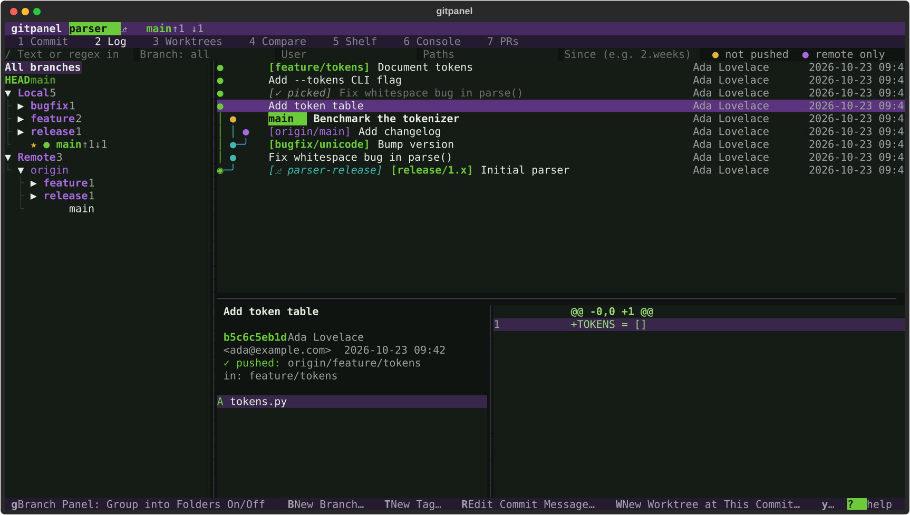
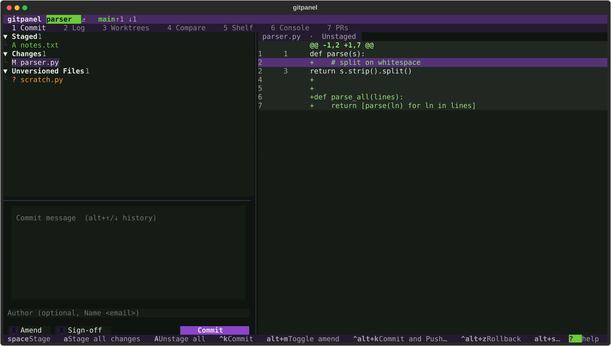
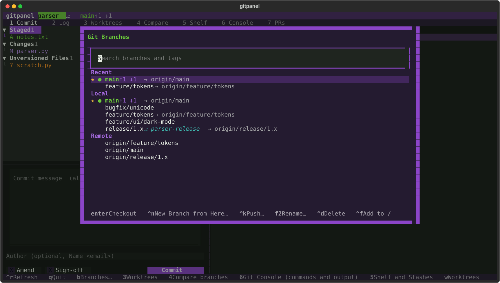
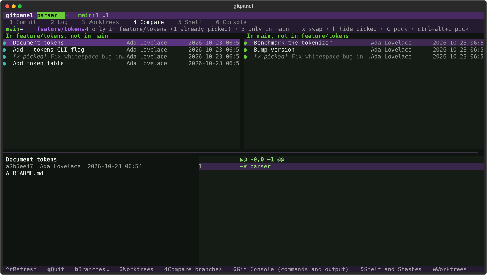
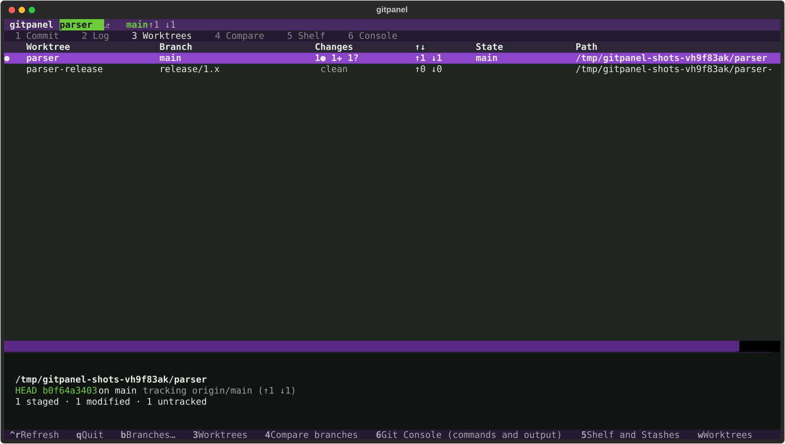
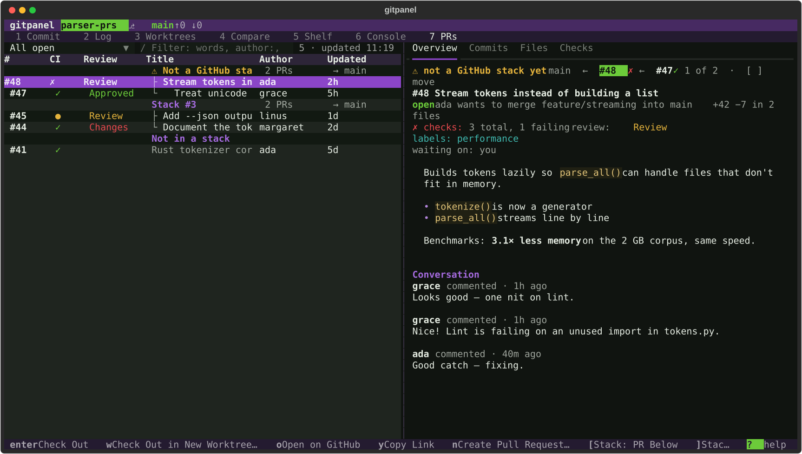
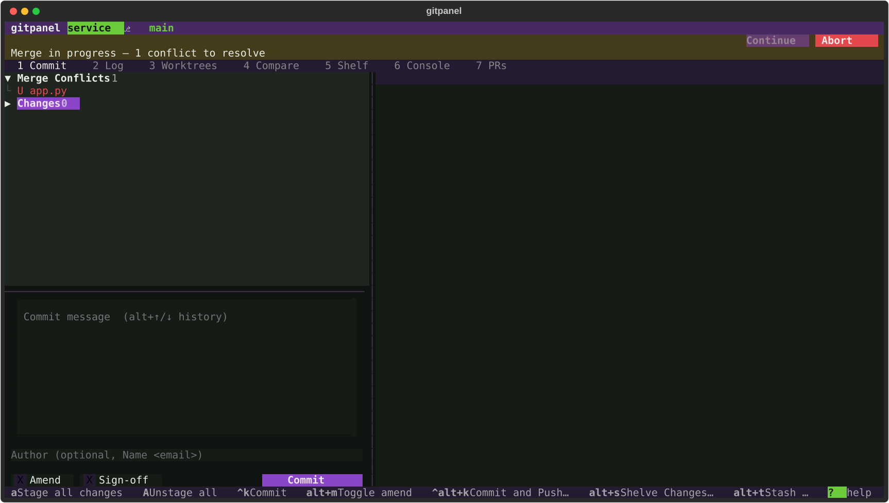
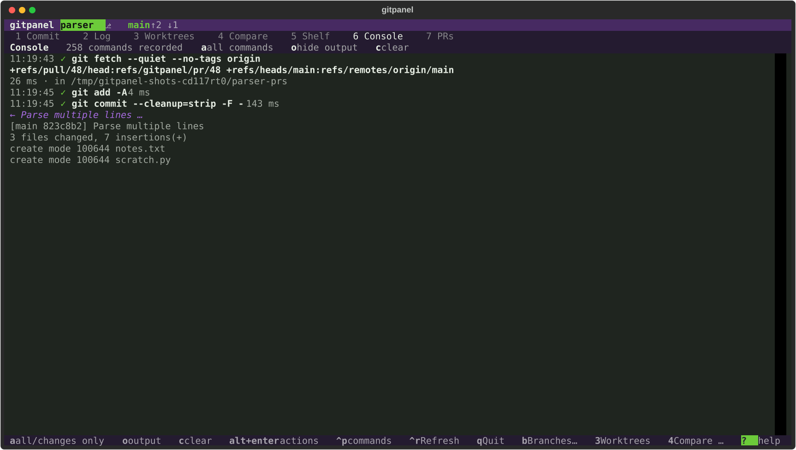

# gitpanel

**Git tooling inspired by PyCharm, in your terminal.**

gitpanel is a keyboard-first Git client for the terminal, modelled on the Git integration in JetBrains IDEs: a commit window with hunk- and line-level staging, a log with a branch graph and a branches panel, worktrees, cherry-picking that knows what you've already picked, a 3-pane conflict resolver, interactive rebase, shelves, GitHub pull requests — and **undo for everything**, including discarded changes.



## Highlights

- **Stage exactly what you mean** — whole files, single hunks or individual lines, in unified or side-by-side diffs. Changelists, amend, sign-off, commit-and-push.
- **A log you can navigate** — coloured branch graph, a branches panel with folders (`feature/…`, `release/…`) to show any branch's history, filters by text, author, path and date, and dots that show what's **not pushed** (amber) or **only on the remote** (purple).
- **Cherry-picking between branches** — pick one or many commits, see which commits are **already picked** (by patch content or `-x` trailer), compare branches side by side, pick onto a branch you don't have checked out, or pick just a hunk or a file.
- **Worktrees as a first-class citizen** — create, switch, filter, lock, move and remove them from a dedicated window; checking out a branch that lives in another worktree takes you there.
- **Conflicts without leaving the terminal** — yours │ result │ theirs, per-chunk accept / combine / edit, then continue the merge, rebase or cherry-pick.
- **History editing** — interactive rebase editor, reword, squash, fixup, drop, and a patch builder that moves hunks between commits.
- **Undo everything** — `z` undoes the last operation (commits, resets, rebases, deleted branches, even discarded changes); `alt+z` shows the full operation history.
- **Pull requests** — filter, sort, check out (even into a fresh worktree), review, comment on lines and merge GitHub PRs, through the `gh` CLI you're already logged into.
- **See what it does** — the Console shows every git (and `gh`) command gitpanel runs and the reply.
- **Make it yours** — remap any key, add your own commands, pick a theme (default: *Hulk*, purple and gamma green).

## Tour

### Commit window
Stage whole files, single hunks or individual lines — unified or side-by-side, changes only or the whole file — with changelists, amend and commit-and-push.



### Branches popup
PyCharm's branches popup: type to filter, favourites first, everything you can do to a branch one keystroke away.



### Compare branches
What's only on either side — commits that are already on your branch (same change, or picked with `-x`) are marked ✓ picked, so you only cherry-pick what's missing.



### Worktrees
Every worktree with its branch, local changes and ahead/behind counts — filter them with `/`. Create, switch, lock, move and remove them without leaving gitpanel.



### Pull requests
Your PRs, the ones waiting for your review, or all of them — with CI and review state, filtering and sorting. Read the conversation, browse commits and files (review comments marked on the diff), check one out, review or merge.



### 3-pane conflict resolver
Yours │ result │ theirs. Take a side, take both or edit each chunk, then save and continue the merge, rebase or cherry-pick.



### Git console
Every git command gitpanel runs, what it sent and what git answered.



## Install

Requires **Python 3.11+** and **git 2.45+**, on Linux or macOS. The Pull requests window also needs the [GitHub CLI](https://cli.github.com) (`gh`).

```bash
pipx install git+https://github.com/lukebierbaum/gitpanel.git
```

Then, inside any repository or worktree:

```bash
gitpanel            # or: gitpanel path/to/repo
```

### Land in the worktree you were using

gitpanel can switch worktrees. Add this to your `~/.bashrc` (or `~/.zshrc`) and launch with `gp` to have your shell `cd` into the worktree that was active when you quit:

```bash
gp() {
  local f; f=$(mktemp)
  gitpanel --cd-file "$f" "$@"
  [ -s "$f" ] && cd "$(cat "$f")"
  rm -f "$f"
}
```

## Getting around

| Key | |
|---|---|
| `1` – `7` | tool windows: **Commit · Log · Worktrees · Compare · Shelf · Console · Pull requests** |
| `b` | Branches popup |
| `?` | every action and its key (filterable) — always shown at the right end of the hint bar |
| `ctrl+p` | command palette |
| `alt+enter` or `.` | actions for whatever is selected |
| `tab` / `shift+tab` | move between panes |
| `z` / `Z` | undo / redo — the hint bar shows what |
| `q` | quit |

Panes can be resized by dragging the thin dividers between them — including the one above the commit message box (double-click resets); sizes are remembered. In the key hints, `^` means Ctrl.

**Lists** — pull requests, PR checks, worktrees and the operation history — all work the same way: `/` filters as you type (`escape` clears), `>` sorts by the next column and `<` reverses it, or click a column header (again to reverse). The sort is remembered.

## Workflows

### Commit
| Key | |
|---|---|
| `space` | stage / unstage the file, group, hunk under the cursor, or selected lines |
| `v`, `shift+↑↓` | select lines in the diff, then `space` |
| `s` | toggle side-by-side diff (`←`/`→` scroll long lines) |
| `enter` on `⋯ N unchanged lines` | show the lines a diff leaves out (or click it); `enter` on its `⌃` row hides them again |
| `f` | whole file / changes only |
| `n` / `p` | next / previous change |
| `a` / `A` | stage all / unstage all |
| `ctrl+k` | commit — `alt+m` amend, `alt+↑↓` message history |
| `ctrl+alt+k` | commit and push |
| `ctrl+alt+z` | roll back a file, hunk or lines (undoable) |
| `f6` | move files to another changelist |
| `alt+s` / `alt+t` | shelve the selection / stash everything |

### Log and branches
| Key | |
|---|---|
| branches panel | highlight a branch to see its history; `space` combines several; `→`/`←` open folders; `g` folders on/off; `[` hide the panel |
| `/` | filter by message (regex); branch, user, path and since filters alongside |
| `shift+↑↓` | select several commits |
| `R` · `S` · `D` · `alt+f` | reword · squash · drop · fold staged changes into a commit |
| `I` | interactive rebase from here (`p r e s f d` to set actions, `alt+↑↓` to reorder) |
| `B` · `T` · `W` | new branch · tag · worktree at a commit |
| `alt+h` / `alt+a` | file history / annotate (blame) |
| `F` · `ctrl+t` · `P` | fetch · update project (merge or rebase) · push dialog |

### Cherry-picking
| Key | |
|---|---|
| `C` | cherry-pick the selected commits onto the current branch (already-picked ones are skipped) |
| `alt+c` | … with options (`-x`, no-commit) |
| `ctrl+alt+c` | cherry-pick onto another branch without checking it out |
| `A` / `G` | apply the selected hunk from a commit / get the whole file from it |
| `b` → `ctrl+e` | Compare window: what's only on either branch, already-picked commits marked ✓ |

### Worktrees (`3`)
`/` filter (name, branch, path, or words like `dirty`, `locked`, `rebase`) · `>`/`<` sort · `n` new · `enter` switch · `d` remove · `m` move · `l` lock · `s` open a shell there · `y` copy path. In the Branches popup, `ctrl+w` makes a worktree for a branch.

### Pull requests (`7`)
Needs the [GitHub CLI](https://cli.github.com) (`gh auth login`). Lists *Mine · Review requested · Assigned · All open · Closed* with CI and review status; the current branch's PR shows in the header (`PR #12 ✓`). The list appears first and CI/review fill in a moment later; a PR's commits are fetched in the background as soon as you select it.

| Key | |
|---|---|
| `/` | filter the list as you type — words, `author:` `label:` `base:` `head:` `status:failure` `review:approved` `draft:false`, `-` to exclude; `enter` runs it as a GitHub search, `escape` clears |
| `>` / `<` | sort by the next column / reverse it (or click a column header; again to reverse) |
| `enter` | check out the PR (Smart / Force Checkout if local changes are in the way) |
| `w` | check it out in a **new worktree** |
| `n` | create a PR from the current branch — pushes it if needed, drafts title and description from its commits (also *Create Pull Request…* on any branch in the Branches popup) |
| `r` · `m` | review (approve / request changes / comment) · comment |
| `M` | merge — squash, merge commit or rebase; delete the branch; auto-merge when checks pass |
| `o` · `y` | open on GitHub · copy link |
| Overview · Commits · Files · Checks | description and conversation · the PR's commits (cherry-pick with `C`) · its diff · CI checks (`enter` opens one; *Re-run Failed Checks* in `alt+enter`) |
| in Files | lines with review comments are marked `◆`; the thread shows under the diff — `c` comment on a line, `R` reply, `x` resolve |

### Conflicts
Conflicted files appear under **Merge Conflicts** in the Commit window, and a banner offers Continue / Skip / Abort. `enter` opens the resolver: `←`/`→` take yours/theirs for the current chunk, `b`/`B` take both, `e` edit, `ctrl+s` save and mark resolved.

### More
Patch builder (on a selection in a commit's diff: `alt+r` remove it from the commit, `alt+n` move it to a new commit, `alt+m` move it to another commit), bisect (`alt+b` / `alt+g` mark bad / good), Smart and Force Checkout when local changes are in the way, and an operation history with undo-to-here (`alt+z`).

## Configuration

`gitpanel --init-config` writes a commented `~/.config/gitpanel/config.toml`:

```toml
theme = "hulk"                 # hulk, hulk-light, or any Textual theme

[diff]
side_by_side = true            # start diffs side-by-side
full_file = false              # start diffs showing the whole file (f toggles)
context = 3

[log]
branch_folders = true          # group feature/x, release/y … in the branches panel

[prs]
refresh_seconds = 180          # refresh the PR window while it's visible (0 = manual)
default_query = "mine"         # mine | review | assigned | open | closed
merge_method = "squash"        # default in the merge dialog

[worktrees]
path_template = "../{repo}.worktrees/{branch}"

[confirm]
destructive = true             # ask before discarding work (it's always backed up)

[keys]                         # remap by action id (see `?`); "a,b" for several keys, "" to unbind
"commit.commit" = "ctrl+s"
```

### Custom commands

Add your own commands; they appear in `?`, the palette and the actions menu:

```toml
[[commands]]
id = "open-pr"
label = "Open pull request"
key = "ctrl+o"
context = "branch"             # global | commit | branch | file | worktree
run = "gh pr view --web {branch}"
output = "none"                # none | popup | terminal
read_only = true               # commands that change the repo are recorded for undo
```

Placeholders — `{repo} {worktree} {commit} {commits} {short} {branch} {ref} {file} {files} {count}` and any `prompts` you define — are shell-quoted. Other braces (`{ print $1 }`, `${VAR}`) are left alone, so multi-line shell snippets work as written.

## Large repositories

On big histories, git answers questions like "which branches contain this commit" much faster with a **commit-graph** — a small local cache (about 60 bytes per commit) that never leaves your machine. Turn it on for every repository:

```bash
git config --global fetch.writeCommitGraph true
```

## How it compares

|  | lazygit | gitui | tig | **gitpanel** |
|---|---|---|---|---|
| Hunk / line staging | ✅ | ✅ | ✅ | ✅ |
| Branch graph, history per branch | ✅ | ✗ | ◐ | ✅ |
| Already-picked commit detection | ✗ | ✗ | ✗ | ✅ |
| Cherry-pick onto a branch you're not on | ✗ | ✗ | ✗ | ✅ |
| 3-pane conflict resolver | ◐ | ✗ | ◐ | ✅ |
| Worktree management | ✅ | ✗ | ✗ | ✅ |
| Undo, including discarded changes | ◐ | ✗ | ✗ | ✅ |
| Shelves and changelists | ✗ | ✗ | ✗ | ✅ |
| Command log / console | ✅ | ✗ | ✗ | ✅ |
| GitHub pull requests (review, merge, line comments) | ◐ | ✗ | ✗ | ✅ |

gitpanel drives the real `git` CLI, so hooks, config, credential helpers and LFS behave exactly as they do on the command line. Feature-by-feature notes against PyCharm are in [docs/PARITY.md](docs/PARITY.md).

## Development

Uses [pixi](https://pixi.sh) for the environment.

```bash
pixi run demo /tmp/gp-demo      # build a demo repository
pixi run start /tmp/gp-demo     # run gitpanel on it
pixi run test                   # 200+ tests against real git repositories (and a fake gh)
pixi run lint
pixi run python scripts/screenshots.py   # regenerate docs/screenshots
```

Built with [Textual](https://textual.textualize.io). Design notes: [architecture](docs/architecture.md) · [roadmap](docs/ROADMAP.md) · [PyCharm parity](docs/PARITY.md) · [contributor guide](CLAUDE.md).

## License

MIT — see [LICENSE](LICENSE).

gitpanel is an independent project, not affiliated with or endorsed by JetBrains. PyCharm is a trademark of JetBrains s.r.o.
